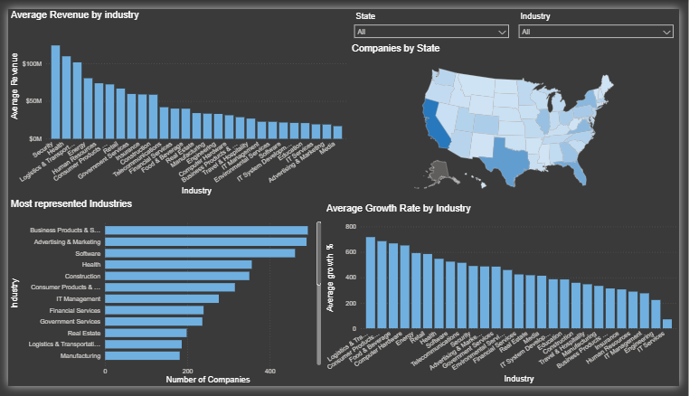
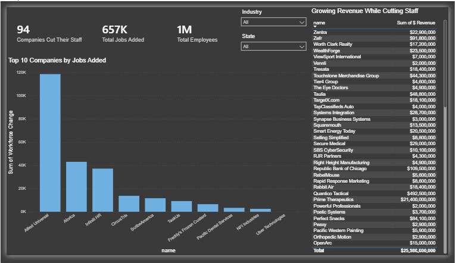

# Inc. 5000 (2019) Companies Analysis (Power BI)

Which industries and states produce the fastest-growing private companies in America, and which of those companies are creating jobs?

This project analyzes the 2019 Inc. 5000 list of fastest-growing private US companies (5,012 companies) in an interactive two-page Power BI dashboard.

## Dashboard

**Page 1: Industry and geography**

**Page 2: Workforce and job creation**

*Full interactive version: download the `.pbix` file and open it in [Power BI Desktop](https://powerbi.microsoft.com/desktop/) (free). The State and Industry slicers filter every visual on the page.*

## Questions Explored
- Which industries earn the highest average revenue, and which grow fastest?
- Which industries and states are most represented on the list?
- How many jobs did these companies add, and who added the most?
- Which companies grew revenue while cutting staff?

## Data
Inc. 5000 2019 list: company name, state, city, industry, revenue, growth rate, current and previous workforce, year founded and years on the list.

Raw dataset: [`data/INC_5000_Companies_2019.csv`](data/INC_5000_Companies_2019.csv)

## Process

1. **Loaded the CSV** into Power BI with Power Query and set the correct data types
2. **Converted revenue to a number**: revenue was stored as text (e.g. `36.9 Million`), so I wrote a custom column that strips the text and multiplies by the right factor for millions and billions, creating `$ Revenue`
3. **Created DAX columns** to analyze workforce changes
   - `Workforce Change` = current workers - previous workers
   - `Reduced Staff` = "Yes" when current workers are below previous workers
4. **Built two dashboard pages** with a bar chart, filled map, KPI cards, a ranked table and State and Industry slicers for cross-filtering

## Key Findings

- **Security, Health and Logistics & Transportation have the highest average revenue** (about $124M, $109M and $101M per company)
- **Logistics & Transportation also grows fastest**, averaging about 718% growth, followed by Consumer Products & Services and Food & Beverage. IT Services grew slowest at about 71%
- **The list is dominated by a few industries**: Business Products & Services (492), Advertising & Marketing (489) and Software (461) are the most represented
- **California leads by a wide margin** with 712 companies, ahead of Texas (467) and Florida (385)
- **657K jobs were added in total**, but one company drives much of it: Allied Universal added about 118,500 jobs (roughly 18% of the total), followed by Alorica (~43,000) and Infiniti HR (~37,000)
- **94 companies cut staff but still made the list**, showing that fast revenue growth does not always mean hiring

## Files
- [`INC_5000_Companies_2019.pbix`](INC_5000_Companies_2019.pbix): Power BI report
- [`data/INC_5000_Companies_2019.csv`](data/INC_5000_Companies_2019.csv): dataset

## Skills Demonstrated
Power Query transformations · Custom columns · DAX calculated columns · Filled map · KPI cards · Slicers and cross-filtering · Multi-page dashboard design

## Tools
Power BI · Power Query · DAX

---
Data: Inc. 5000 2019 list of America's fastest-growing private companies.
